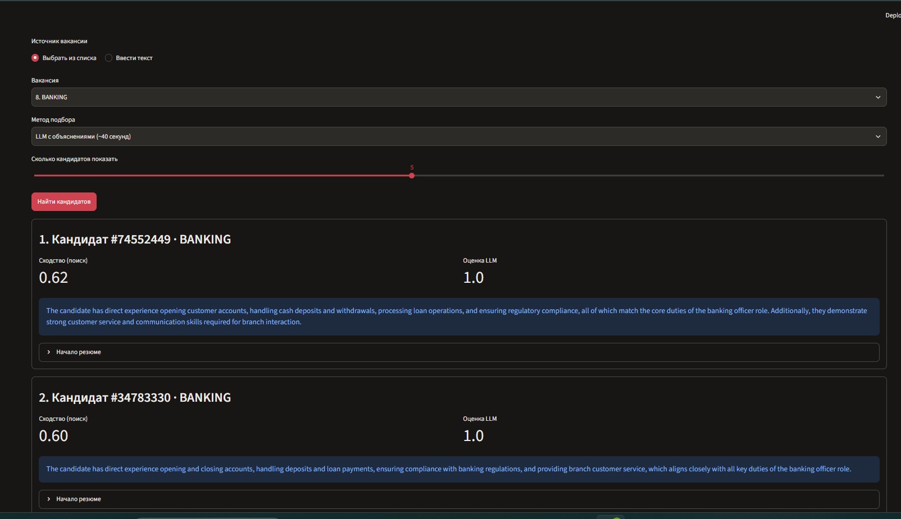
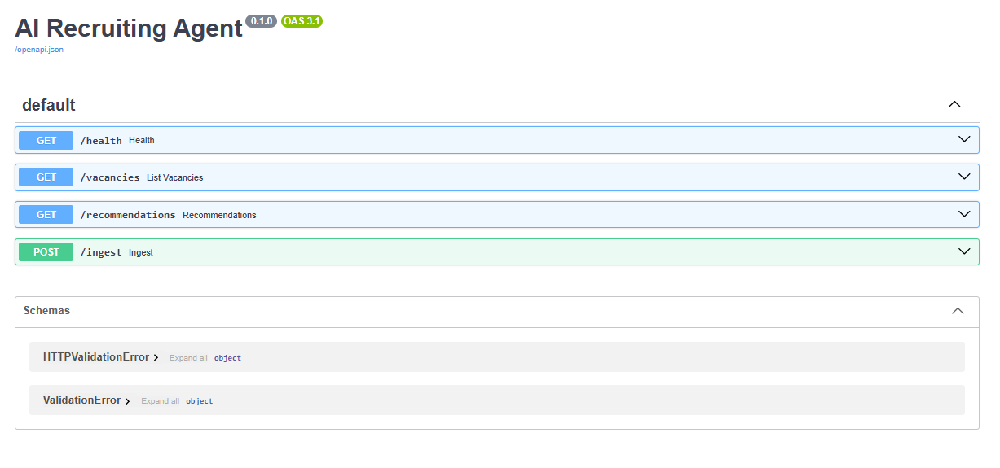
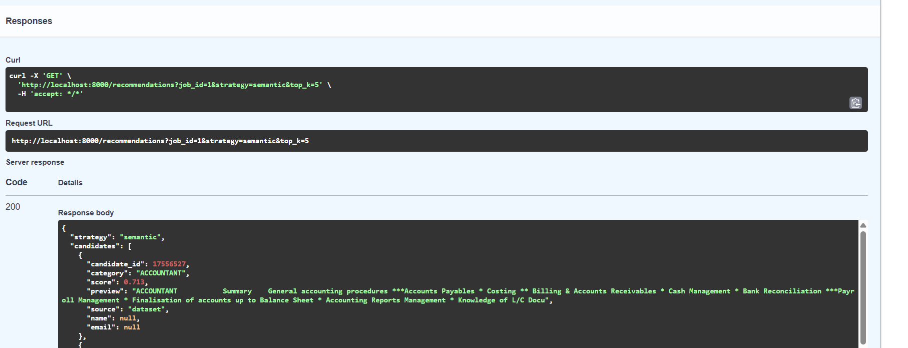

# AI Recruiting Agent

Прототип ИИ-агента для рекрутеров: система сама забирает резюме из почты, разбирает их и подбирает кандидатов, которые лучше всего подходят под вакансию. Для каждого кандидата LLM объясняет, почему он подходит или не подходит.



## Возможности

- **Интеграция с почтой**: забирает непрочитанные письма за последние 3 дня, сохраняет вложения PDF и DOCX и отсеивает документы, которые не похожи на резюме (счета, квитанции).
- **Парсинг резюме** в структурированный формат: имя, email, телефон, навыки, опыт работы, образование.
- **Три метода подбора**: TF-IDF, Sentence-BERT и LLM-переранжирование с объяснениями.
- **Классификатор категорий**: TF-IDF + Logistic Regression, определяет профессиональную область резюме.
- **Русский и английский**: мультиязычная модель эмбеддингов, а LLM отвечает на языке вакансии.
- **REST API** на FastAPI: `GET /recommendations?job_id=...` возвращает топ-K кандидатов.
- **Интерфейс** на Streamlit для рекрутера.
- **Docker Compose**: API и интерфейс запускаются одной командой.

## Архитектура

```
┌──────────────┐   PDF/DOCX   ┌──────────────┐  JSON   ┌───────────────────────────┐
│  Gmail IMAP  │ ───────────► │    Парсер    │ ──────► │    Кандидаты               │
│ (непрочит.)  │              │ текст, навыки│         │ Resume.csv + резюме почты  │
└──────────────┘              └──────────────┘         └─────────────┬─────────────┘
                                                                     │
                                         ┌───────────────────────────▼──────────────┐
                                         │   Поиск: TF-IDF или Sentence-BERT        │
                                         │   → топ-10 кандидатов                    │
                                         └───────────────────────────┬──────────────┘
                                                                     │
                                         ┌───────────────────────────▼──────────────┐
                                         │   LLM (Groq): оценка 0–1 + объяснение    │
                                         │   → топ-5 кандидатов                     │
                                         └───────────────────────────┬──────────────┘
                                                                     │
                     ┌──────────────┐     HTTP      ┌────────────────▼──┐
                     │  Streamlit   │ ◄───────────► │      FastAPI       │
                     │ (рекрутер)   │               │  /recommendations  │
                     └──────────────┘               └────────────────────┘
```

Интерфейс ничего не считает сам: он только отправляет запросы в API. Вся логика (парсинг, поиск, LLM) живёт в модулях `src/` и не зависит от интерфейса, поэтому её можно использовать из API, ноутбуков или другого клиента.

## Методы подбора

### 1. TF-IDF + косинусное сходство

Каждый текст превращается в вектор весов слов. Слово получает большой вес, если оно часто встречается в этом резюме и редко во всех остальных: например, `kubernetes` или `accounting` весят больше, чем `experience` или `team`. Вакансия и резюме сравниваются по косинусному сходству.

- **Сильная сторона**: быстро, понятно, хорошо ловит точные термины и технологии.
- **Слабая сторона**: сравнивает слова буквально и не знает синонимов (`attorney` и `lawyer` для него разные слова).

Перед векторизацией текст очищается: нижний регистр, удаление шаблонных слов датасета, лишних символов и пробелов. Символы `+`, `#` и `.` сохраняются, чтобы не терять навыки вроде `c++`, `c#`, `.net`.

**Классификатор категорий.** На тех же TF-IDF признаках обучена Logistic Regression, которая определяет категорию резюме (24 класса). Из-за дисбаланса классов используется `class_weight="balanced"`: accuracy **0.66**, macro F1 **0.64**.

### 2. Sentence-BERT (семантический поиск)

Модель `paraphrase-multilingual-MiniLM-L12-v2` превращает текст в вектор из 384 чисел, который описывает **смысл** текста. Тексты с похожим смыслом получают похожие векторы, даже если в них разные слова или разные языки. Например, `machine learning engineer` и `специалист по искусственному интеллекту` получают сходство 0.66, а с `chef in a restaurant` только 0.23.

- **Сильная сторона**: понимает синонимы и перефразирование, работает с русским и английским.
- **Ограничение**: модель читает только первые ~128 токенов (около 100 слов) текста.

Эмбеддинги резюме считаются один раз и кэшируются в файл `.npy`.

### 3. LLM-переранжирование (retrieve + rerank)

Отправлять в LLM все резюме долго и дорого, поэтому поиск идёт в два этапа:

1. Sentence-BERT быстро выбирает топ-10 кандидатов из всех резюме;
2. LLM (`openai/gpt-oss-120b` через Groq) читает каждое из 10 резюме, ставит оценку от 0 до 1 по заданной шкале и пишет объяснение на 2–3 предложения.

Промпт задаёт роль («опытный рекрутер»), шкалу оценок с описанием каждого уровня, требование быть строгим (защита от завышенных оценок) и формат ответа строго в JSON. `temperature=0` делает ответы воспроизводимыми.

- **Сильная сторона**: объяснимость. Рекрутер видит не просто число, а причину, например: *«Кандидат имеет опыт бухгалтерии и налогового учёта, но в резюме нет упоминания работы с 1С, что является ключевым требованием вакансии»*.
- **Слабая сторона**: медленно (~40 секунд на вакансию) и упирается в лимиты API.

## Результаты

**Как оценивали.** Для каждой из 24 категорий датасета написана эталонная вакансия. Для каждой вакансии считается **Precision@5**: доля резюме нужной категории среди первых пяти кандидатов. Итог усредняется по 24 вакансиям. Случайный выбор дал бы около 0.04 (1/24).

| Подход | Precision@5 | Объяснения | Время на вакансию |
|---|---|---|---|
| TF-IDF | 0.73 | нет | доли секунды |
| Sentence-BERT (начало резюме) | **0.775** | нет | доли секунды |
| Sentence-BERT (всё резюме, усреднение по кускам) | 0.725 | нет | доли секунды |
| Sentence-BERT + LLM rerank | **0.775** | **есть** | ~40 секунд |

**Выводы:**

- **Sentence-BERT лучше TF-IDF** за счёт понимания смысла. Особенно это видно на сложных категориях: для `CONSULTANT` Precision@5 выросла с 0.2 до 0.8. При этом TF-IDF был лучше на `AUTOMOBILE` и `BPO`, где важны конкретные термины: у подходов разные сильные стороны.
- **Разбиение на куски ухудшило результат.** Модель читает только первые ~100 слов, а среднее резюме около 800 слов, поэтому мы разбили резюме на куски, закодировали каждый и усреднили векторы. Модель стала «видеть» всё резюме, но качество упало с 0.775 до 0.725. Причина: самая информативная часть резюме (должность и краткое описание) стоит в начале, а при усреднении она растворяется среди обязанностей, образования и общих фраз. Вывод: идея, которая звучит логично, не обязательно улучшает результат, поэтому каждое изменение нужно измерять.
- **LLM не подняла Precision@5**, по двум причинам. Во-первых, LLM не ищет сама, а только переставляет кандидатов внутри топ-10 от Sentence-BERT и не может добавить тех, кого поиск не нашёл. Во-вторых, «правильный ответ» в датасете это категория-отрасль, а не должность: LLM оценивает реальное соответствие резюме вакансии, и её разумное решение может засчитываться как ошибка. Главная ценность LLM в объяснениях, которых нет у других методов.

## Примеры работы

### Вакансия на русском языке

LLM отвечает на языке вакансии и строго оценивает соответствие требованиям: кандидат с опытом бухгалтерии получает 0.4, потому что в резюме нет 1С.


### REST API

Автоматическая документация FastAPI:



Ответ эндпоинта `/recommendations`:



## Как запустить

### Подготовка

1. Скачать датасет [Resume Dataset](https://www.kaggle.com/datasets/snehaanbhawal/resume-dataset) с Kaggle и положить `Resume.csv` в `data/eval/Resume.csv`.
2. Создать в корне проекта файл `.env`:

```
GROQ_API_KEY=ваш_ключ_groq
GMAIL_USER=ваша_почта@gmail.com
GMAIL_APP_PASSWORD=пароль_приложения_gmail
```

- ключ Groq создаётся бесплатно на [console.groq.com](https://console.groq.com);
- для Gmail нужен **пароль приложения** (Google-аккаунт → Безопасность → Пароли приложений), обычный пароль от почты не подойдёт.

### Через Docker (рекомендуется)

```
docker compose up --build
```

Первая сборка займёт 10–20 минут. После запуска:

- интерфейс: http://localhost:8501
- документация API: http://localhost:8000/docs

### Локально

```
python -m venv .venv
.venv\Scripts\activate            # Windows
pip install -r requirements.txt
```

В двух терминалах из корня проекта:

```
uvicorn src.api:app --reload      # терминал 1: API
streamlit run src/ui.py           # терминал 2: интерфейс
```

Забрать резюме из почты вручную: `python -m src.mail_client`, или кнопкой «Забрать резюме из почты» в интерфейсе.

## API

| Метод | Путь | Описание |
|---|---|---|
| `GET` | `/health` | Проверка, что сервис работает |
| `GET` | `/vacancies` | Список вакансий |
| `GET` | `/recommendations` | Топ-K кандидатов под вакансию |
| `POST` | `/ingest` | Забрать резюме из почты и добавить их в поиск |

Параметры `/recommendations`:

| Параметр | Тип | Описание |
|---|---|---|
| `job_id` | int | Номер вакансии из `/vacancies` |
| `text` | str | Текст вакансии (вместо `job_id`) |
| `strategy` | `tfidf` / `semantic` / `llm` | Метод подбора, по умолчанию `semantic` |
| `top_k` | int, 1–20 | Сколько кандидатов вернуть, по умолчанию 5 |

Нужно указать **либо** `job_id`, **либо** `text`, иначе API вернёт `400`. Если LLM недоступна (например, исчерпан лимит), API вернёт `503` с понятным сообщением.

Пример запроса:

```
GET http://localhost:8000/recommendations?job_id=1&strategy=llm&top_k=5
```

Пример ответа (сокращённо):

```json
{
  "strategy": "llm",
  "candidates": [
    {
      "candidate_id": 17306905,
      "category": "ACCOUNTANT",
      "score": 0.693,
      "preview": "SENIOR ACCOUNTANT  Experience  Senior Accountant ...",
      "source": "dataset",
      "name": null,
      "email": null,
      "llm_score": 1.0,
      "explanation": "The candidate has extensive experience with general ledger entries, accounts payable/receivable processes, tax return preparation ..."
    }
  ]
}
```

## Ограничения и что можно улучшить

**Ограничения текущего прототипа:**

- **Лимиты бесплатного Groq**: 8 000 токенов в минуту и 200 000 в день. Оценка LLM на 24 вакансиях заняла два дня, а один запрос с LLM идёт около 40 секунд.
- **Распознавание резюме** во вложениях работает по простому правилу: есть секция «опыт» или «образование», либо найдено 3+ навыка. Резюме без привычных заголовков может не пройти.
- **Навыки и заголовки секций** ищутся по словарям (`data/skills.txt`, `SECTION_HEADERS`). Всё, чего нет в словаре, не находится.
- **Сущности (имя, контакты) извлекаются правилами**: regex для email и телефона, имя как первая строка резюме. NER-модель (например, spaCy) пока не используется.
- **Датасет размечен по отраслям, а не по должностям**, и он только на английском. Поэтому метрика Precision@5 по категориям приблизительная.
- **Sentence-BERT читает только начало резюме** (~128 токенов).
- **Почта забирается вручную**: командой или кнопкой, без расписания. Для прототипа используется личный ящик; в реальной системе нужен отдельный ящик для откликов.
- **Нет базы данных**: кандидаты хранятся в файлах, дубликаты определяются только по имени файла.

**Что можно улучшить:**

- **Гибридный поиск** (например, Reciprocal Rank Fusion): объединить TF-IDF и Sentence-BERT, у которых разные сильные стороны.
- **Модель с длинным контекстом** (например, `bge-m3`, до 8192 токенов) или сравнение вакансии с **лучшим** куском резюме вместо усреднения.
- **NER на spaCy** для имён, компаний и университетов, и/или **парсинг резюме через LLM**.
- **Автоматическое обновление**: забирать почту по расписанию (cron, Celery Beat).
- **PostgreSQL + pgvector** для хранения кандидатов и векторного поиска.
- **Разметка «вакансия — подходящие кандидаты»** для более честной оценки качества.

## Структура проекта

```
ats/
├── src/
│   ├── text_cleaning.py   # очистка текста для TF-IDF и эмбеддингов
│   ├── parser.py          # PDF/DOCX → текст, контакты, навыки, секции
│   ├── mail_client.py     # забор резюме из Gmail по IMAP
│   ├── matching.py        # TF-IDF, Sentence-BERT, LLM rerank
│   ├── api.py             # FastAPI: /recommendations, /vacancies, /ingest
│   └── ui.py              # интерфейс на Streamlit
├── notebooks/
│   ├── 01_explore_data.ipynb   # знакомство с датасетом
│   ├── 02_tfidf.ipynb          # TF-IDF, классификатор, оценка Precision@5
│   ├── 03_semantic.ipynb       # Sentence-BERT, эксперимент с кусками
│   ├── 04_llm.ipynb            # LLM-переранжирование и оценка
│   └── 05_parsing.ipynb        # парсинг PDF/DOCX
├── data/
│   ├── skills.txt         # словарь навыков
│   ├── vacancies.json     # 24 вакансии для API и оценки
│   ├── eval/              # Resume.csv и кэш эмбеддингов (не в git)
│   ├── resumes/           # резюме из почты (не в git)
│   └── parsed/            # разобранные резюме в JSON (не в git)
├── docs/screenshots/      # скриншоты для README
├── Dockerfile
├── docker-compose.yml
├── requirements.txt
└── .env                   # ключи (не в git)
```
